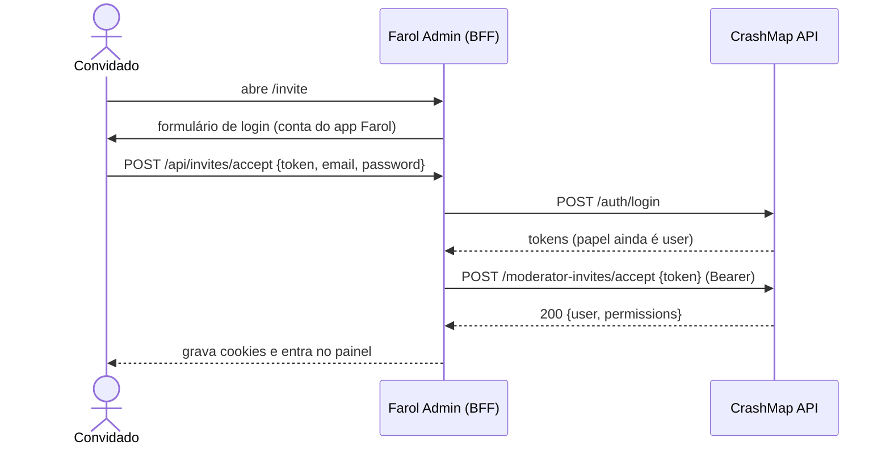

# Arquitetura — Farol Admin

Painel web de moderação do ecossistema Farol. Consome a **CrashMap API**, que é
a única autoridade sobre autenticação e permissões: o painel só decide o que
mostrar.

Stack: Next.js 16 (App Router), React 19 e TypeScript. Sem bibliotecas de
estado, de requisição ou de UI: estilos em `app/globals.css`, chamadas com
`fetch` e estado com hooks do React.

## 1. Estrutura de pastas

```text
app/
├── (panel)/                 páginas autenticadas (route group, não aparece na URL)
│   ├── layout.tsx           exige sessão com panel:access e injeta o PermissionsProvider
│   ├── page.tsx             visão geral (dashboard)
│   ├── reports/             fila de moderação e detalhe do relato ([id])
│   ├── moderation-history/
│   ├── notices/             avisos à comunidade
│   ├── team/                equipe e convites
│   ├── users/
│   ├── audit/
│   └── settings/
├── api/                     BFF (Route Handlers)
│   ├── admin/[...path]/     proxy com lista fechada de rotas da API
│   ├── auth/login/
│   ├── auth/logout/
│   └── invites/accept/
├── components/              componentes compartilhados (shell, diálogos, paginação, permissões…)
├── invite/                  aceite de convite (pública)
├── login/
├── sem-permissao/
├── layout.tsx
└── globals.css
lib/
├── api/                     funções de chamada por domínio (audit, history, moderation, notices, settings, team, users)
├── backend.ts               acesso à API pelo servidor (BFF)
├── client-api.ts            adminFetch: chamadas do navegador ao BFF
├── session.ts               getSession / requirePagePermission (somente servidor)
├── session-tokens.ts        cookies, refresh e IP do cliente (sem next/headers)
├── permissions.ts           tipo Permission, SessionUser e rótulo do papel
├── types.ts                 tipos das respostas da API
└── errors.ts, format.ts, map.ts
proxy.ts                     checagem otimista de sessão e renovação do token
```

### Organização de cada tela

Cada tela em `app/(panel)/<tela>/` segue o mesmo padrão:

```text
page.tsx            Server Component: requirePagePermission(...) e metadata
<tela>-client.tsx   Client Component com o AdminShell e a composição da tela
use-<algo>.ts       hooks com o estado e as chamadas da tela
_components/        componentes usados só por essa tela
```

Fluxo de dados no navegador:

```text
<tela>-client.tsx → use-*.ts → lib/api/*.ts → adminFetch → /api/admin/... (BFF) → CrashMap API
```

## 2. BFF e comunicação com a API

O navegador **nunca** recebe tokens nem fala direto com a API.

- Os tokens ficam em cookies `HttpOnly`, `SameSite=Lax` e `Secure` em produção
  (`farol_admin_access`, 1 h; `farol_admin_refresh`, 30 dias), definidos em
  `lib/session-tokens.ts`.
- `CRASHMAP_API_URL` é variável de servidor (sem `NEXT_PUBLIC_`).
- `app/api/admin/[...path]/route.ts` mantém uma **tabela fechada de rotas**
  (`{ method, pattern, backend, permission }`). Qualquer rota fora dela responde
  `404` sem tocar na API. O campo `permission` é documentação; quem checa é a
  API.
- `proxyAdminRequest` (`lib/backend.ts`) anexa o `Bearer`, repassa o corpo e,
  se a API responder `401`, troca o refresh token e tenta uma vez de novo.
  Métodos aceitos: `GET`, `POST` e `PATCH`.
- Erros do próprio BFF seguem o formato da API (`{ error: { code, message } }`):
  `AUTH_REQUIRED` (401), `API_UNAVAILABLE` (502), `API_NOT_CONFIGURED` (503),
  `NOT_FOUND` (404).
- O BFF repassa o IP do navegador em `X-Forwarded-For` (o **último** item do
  cabeçalho recebido), usado pela API na auditoria e nos limites de tentativas.

### Rotas da API usadas pelo painel

| BFF (`/api/admin/…`) | API | Permissão exigida pela API |
|---|---|---|
| `GET moderation/summary` | `/accidents/moderation/summary` | `stats:read` |
| `GET moderation` | `/accidents/moderation` | `reports:read` |
| `GET moderation/:id` | `/accidents/moderation/:id` | `reports:read` |
| `PATCH moderation/:id` | `/accidents/moderation/:id` | `reports:moderate` |
| `PATCH :id/moderation` | `/accidents/:id/moderation` | `reports:moderate` |
| `GET moderation-history[/moderators]` | `/admin/moderation-history…` | `moderation_history:read` |
| `GET` / `POST moderator-invites` | `/admin/moderator-invites` | `invites:manage` / `moderators:invite` |
| `POST moderator-invites/:id/(resend\|revoke)` | `/admin/moderator-invites/…` | `invites:manage` |
| `GET moderators`, `POST moderators/:id/revoke` | `/admin/moderators…` | `moderators:revoke` |
| `GET users[/:id]`, `POST users/:id/(suspend\|reactivate\|sessions/revoke)` | `/admin/users…` | `users:manage` |
| `GET audit-logs` | `/admin/audit-logs` | `audit:read` |
| `GET` / `PATCH settings` | `/admin/settings` | `settings:manage` |
| `GET` / `POST notifications/administrative-notices` | `/notifications/administrative-notices` | autenticado / `notices:publish` |

Além do proxy, há três Route Handlers próprios:

- `POST /api/auth/login`: faz login na API e só grava os cookies se o usuário
  tiver `panel:access` e e-mail verificado (senão `403 ADMIN_ACCESS_REQUIRED`).
- `POST /api/auth/logout`: revoga o refresh token na API e limpa os cookies.
- `POST /api/invites/accept`: ver §5.

## 3. Sessão

| Peça | Papel |
|---|---|
| `proxy.ts` | Roda antes das páginas do painel (exclui `api`, `login`, `invite`, `sem-permissao` e estáticos). Sem cookie de sessão → `/login?next=…`. Com access token vencido (lê só o `exp`, sem validar), troca o refresh token e grava os cookies novos na requisição e na resposta — fica aqui porque Server Components não gravam cookies. Se a API estiver fora do ar, deixa a página renderizar. |
| `lib/session.ts` → `getSession()` | Chama `GET /auth/me` com o cookie, envolto em `cache()` do React (uma chamada por requisição). Devolve `{ id, name, email, role, permissions }`. |
| `lib/session.ts` → `requirePagePermission(p?)` | Sem sessão → `/login`; sem `panel:access` ou sem `p` → `/sem-permissao`. |
| `app/(panel)/layout.tsx` | Chama `requirePagePermission()` e envolve as páginas no `PermissionsProvider`. |
| `page.tsx` de cada tela | Chama `requirePagePermission("<permissão>")` de novo, porque layouts não são reavaliados a cada navegação. |
| `app/sem-permissao` | Mensagem, link para a visão geral (se ainda houver `panel:access`) e botão de sair. |

### Reação a 401 e 403

`adminFetch` (`lib/client-api.ts`) dispara eventos no `window`:

- `401` → `farol:unauthorized` → carregamento completo de `/login`;
- `403` com código `AUTH_*` → `farol:forbidden` → `router.refresh()`.

`useSessionEvents` (montado pelo `AdminShell`) escuta esses eventos. O refresh
reexecuta `getSession()` no servidor; se a pessoa perdeu `panel:access` (por
exemplo, um moderador removido com o painel aberto), as páginas redirecionam.

## 4. Permissões na interface

Princípio: **a interface esconde, a API decide.**

O painel não conhece o mapa papel → permissão. `lib/permissions.ts` só espelha
o tipo `Permission` da API; a lista efetiva chega pronta em `user.permissions`.

| Permissão | Moderador | Administrador |
|---|:-:|:-:|
| `panel:access` | ✅ | ✅ |
| `reports:read` | ✅ | ✅ |
| `reports:moderate` | ✅ | ✅ |
| `moderation_history:read` | ✅ | ✅ |
| `stats:read` | ✅ | ✅ |
| `notices:publish` | ✅ | ✅ |
| `moderators:invite` | | ✅ |
| `moderators:revoke` | | ✅ |
| `invites:manage` | | ✅ |
| `users:manage` | | ✅ |
| `audit:read` | | ✅ |
| `settings:manage` | | ✅ |

Helpers em `app/components/permissions-provider.tsx` (client):

- `PermissionsProvider` — recebe o `SessionUser` do layout;
- `useSessionUser()` — usuário da sessão (nome e papel real no topo);
- `usePermissions()` — devolve `can(permission)`;
- `useCan(permission)` e `<Can permission fallback>` — atalhos.

A navegação (`app/components/shell/navigation.ts`) é declarativa; o
`AdminShell` filtra os itens por permissão:

| Rota | Tela | Permissão |
|---|---|---|
| `/` | Visão geral | `stats:read` |
| `/reports` | Relatos (fila e detalhe) | `reports:read` |
| `/moderation-history` | Histórico de moderação | `moderation_history:read` |
| `/notices` | Avisos à comunidade | `notices:publish` |
| `/team` | Equipe e convites | `invites:manage` |
| `/users` | Usuários | `users:manage` |
| `/audit` | Auditoria | `audit:read` |
| `/settings` | Configurações | `settings:manage` |
| `/invite` | Aceite de convite | pública |
| `/sem-permissao` | Sem permissão | autenticada |

Comportamento:

- recurso que o papel não tem → **escondido** (menu, botão, página);
- ação permitida mas inválida no estado atual (ex.: relato já moderado) →
  **desabilitada**;
- ações destrutivas (remover moderador, revogar convite, suspender conta, sair)
  → diálogo de confirmação; remover moderador e suspender/reativar/encerrar
  sessões de uma conta exigem motivo.

## 5. Aceite de convite



- O token vem no **fragmento** (`#token=`), que não vai para logs nem para o
  `Referer`; a tela o tira da barra de endereço assim que o lê.
- O login comum (`/api/auth/login`) recusa quem não é staff, por isso o aceite
  tem rota própria: login na API, aceite com o access token e **só então** os
  cookies. Se o aceite falhar, o BFF chama `/auth/logout` para revogar o refresh
  token recém-criado e não grava cookie nenhum.
