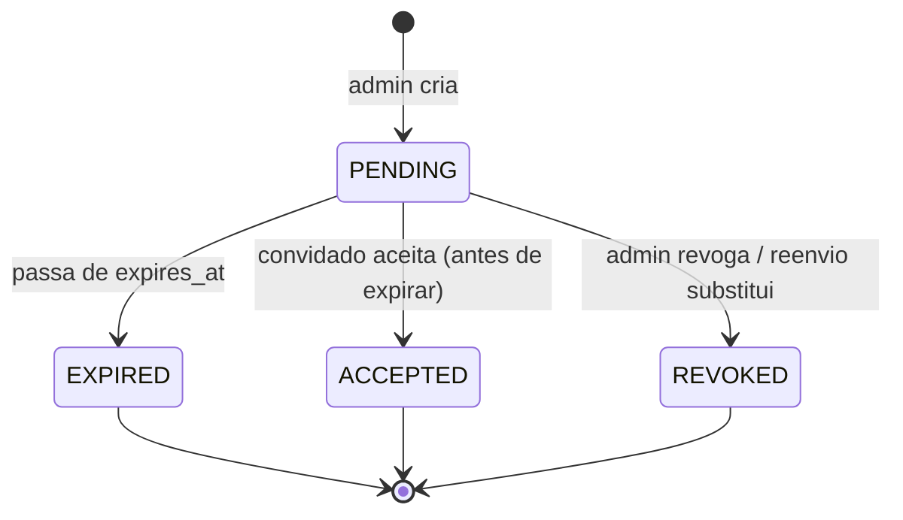
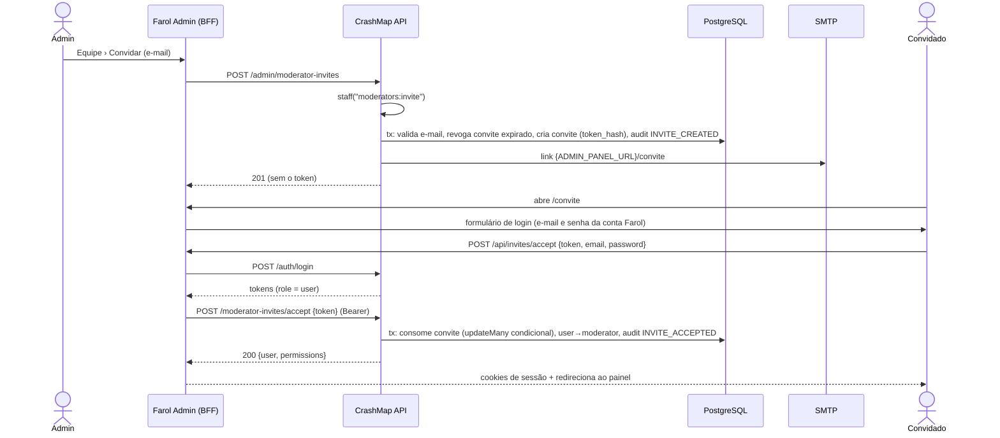

# Arquitetura de permissões — Farol Admin + CrashMap API

> Proposta técnica. Nada aqui foi implementado ainda. As referências a arquivos
> apontam para o estado atual de `farol-admin` (branch `development`) e
> `crashmap-api` (commit `0b79215`).

## 1. Diagnóstico do estado atual

### O que já está bom

| Ponto | Onde |
|---|---|
| Enum `role { user, moderator, admin }` no banco | `crashmap-api/prisma/schema.prisma` |
| `requireAuthenticatedUser` **relê o usuário no banco a cada requisição**; o `role` do JWT não é usado para autorizar. Rebaixar alguém vale na próxima chamada, sem esperar o token expirar. | `crashmap-api/src/modules/auth/auth.guard.ts` |
| `requireRole(...)` e `requireModerator` já existem como `preHandler` | idem |
| Toda decisão de moderação grava uma linha em `AccidentModerationHistory` (quem, status anterior/novo, mensagens) na **mesma transação** da decisão, com proteção contra corrida (`updateMany ... where PENDING`) | `accidents.service.ts` → `moderateAccident` |
| O painel não expõe tokens ao navegador (BFF com cookies `HttpOnly`) e o proxy só repassa uma lista fechada de rotas | `lib/backend.ts`, `app/api/admin/[...path]/route.ts` |

### Lacunas e riscos encontrados

1. **Não existe distinção entre MODERATOR e ADMIN.** Todas as rotas administrativas usam `requireModerator` (`moderator` *ou* `admin`). Não há nenhuma rota exclusiva de ADMIN.
2. **Checagens de papel espalhadas no serviço.** `canManageAccident` (`accidents.service.ts:169`) e a checagem da linha ~972 dão a moderadores e admins poder de **editar e apagar qualquer relato pelas rotas públicas** (`PATCH /accidents/:id`, `DELETE /accidents/:id`, exclusão de comentários/imagens). Esse poder **será mantido** (decisão §11), mas hoje ele usa `role === …` em vez de permissão e **não deixa rastro**: um moderador pode apagar um relato sem que ninguém saiba quem foi. A proposta mantém o poder e passa a auditá-lo (§3.4).
3. **O painel não conhece o papel do usuário.** O login do BFF valida o papel e descarta a informação; o `AdminShell` mostra “Administrador” fixo e o avatar “A” para qualquer pessoa; só o e-mail é guardado em `sessionStorage`. Não há como esconder ações por papel hoje.
4. **Remover um moderador não encerra sessões.** Não existe rotina de rebaixamento; se fosse feita via SQL, os refresh tokens continuariam válidos (o guard bloquearia as rotas, mas a sessão continuaria “viva” no painel).
5. **Bug latente na exclusão de conta.** `deleteMe` bloqueia contas com papel ≠ `user`, mas um ex-moderador rebaixado para `user` passa na checagem e o `prisma.user.delete` falha com violação de FK (`AccidentModerationHistory.moderated_by` e `AdministrativeNotice.created_by` são `onDelete: Restrict`) → erro 500. Ao mesmo tempo, **não podemos perder** a autoria das decisões.
6. **Ações fora da tabela pedida:** publicar *avisos à comunidade* (hoje permitido a moderadores) e editar o texto de um relato pendente (`PATCH /accidents/moderation/:id`). Precisam de uma decisão explícita (ver §11).
7. **Bootstrap de papéis por SQL manual** (README). Funciona, mas não deixa auditoria.
8. Detalhes: `cors({ origin: true })` aceita qualquer origem; não há rate limit; `request.ip` atrás de proxy exigirá `trustProxy` para a auditoria registrar o IP real.

## 2. Modelo de autorização: papéis → permissões

Os papéis continuam sendo três e fixos (não vale a pena um RBAC configurável em
banco). Mas **as rotas e a interface checam permissões, nunca papéis**. O
mapeamento papel → permissões fica em **um único arquivo** na API, e o painel
recebe a lista pronta.

| Permissão | Descrição | USER | MODERATOR | ADMIN |
|---|---|:-:|:-:|:-:|
| `panel:access` | Entrar no painel | | ✅ | ✅ |
| `reports:read` | Listar e ver relatos na fila de moderação | | ✅ | ✅ |
| `reports:moderate` | Aprovar / rejeitar, editar texto de pendente, editar/apagar relatos, comentários e imagens de terceiros | | ✅ | ✅ |
| `moderation_history:read` | Consultar histórico de moderação | | ✅ | ✅ |
| `stats:read` | Estatísticas gerais | | ✅ | ✅ |
| `notices:publish` | Avisos à comunidade | | ✅ | ✅ |
| `moderators:invite` | Convidar moderadores | | | ✅ |
| `moderators:revoke` | Remover permissão de moderador | | | ✅ |
| `invites:manage` | Listar, reenviar e revogar convites pendentes | | | ✅ |
| `users:manage` | Gerenciar contas (listar, suspender, reativar, encerrar sessões) | | | ✅ |
| `audit:read` | Auditoria administrativa | | | ✅ |
| `settings:manage` | Configurações da plataforma | | | ✅ |

Por que permissões e não papéis: amanhã “moderador sênior pode ver auditoria”
vira uma linha no mapa, sem caçar `role === "admin"` em controllers, serviços e
componentes React.

## 3. Back-end (CrashMap API / Fastify)

### 3.1 Fonte única das permissões

`src/modules/auth/permissions.ts`

```ts
import type { UserRole } from "./auth.types.js";

export const PERMISSIONS = [
    "panel:access",
    "reports:read",
    "reports:moderate",
    "moderation_history:read",
    "stats:read",
    "notices:publish",
    "moderators:invite",
    "moderators:revoke",
    "invites:manage",
    "users:manage",
    "audit:read",
    "settings:manage",
] as const;

export type Permission = (typeof PERMISSIONS)[number];

const MODERATOR: readonly Permission[] = [
    "panel:access",
    "reports:read",
    "reports:moderate",
    "moderation_history:read",
    "stats:read",
    "notices:publish",
];

const ROLE_PERMISSIONS: Record<UserRole, ReadonlySet<Permission>> = {
    user: new Set(),
    moderator: new Set(MODERATOR),
    admin: new Set(PERMISSIONS), // ADMIN = tudo
};

export function permissionsFor(role: UserRole): Permission[] {
    return [...ROLE_PERMISSIONS[role]];
}

export function can(user: { role: UserRole }, permission: Permission) {
    return ROLE_PERMISSIONS[user.role].has(permission);
}
```

### 3.2 Guards

Em `auth.guard.ts`, adicionar:

```ts
export function requirePermission(...required: Permission[]): preHandlerHookHandler {
    return async (request) => {
        const user = request.authUser;
        if (!user) throw new AuthError("Authenticated user not found", 401, "AUTH_USER_NOT_FOUND");
        if (!required.every((p) => can(user, p))) {
            throw new AuthError(
                "You do not have permission to perform this action",
                403,
                "AUTH_MISSING_PERMISSION",
            );
        }
    };
}

// Conta suspensa não usa nada além de logout.
export const requireActiveAccount: preHandlerHookHandler = async (request) => {
    if (request.authUser?.suspended_at) {
        throw new AuthError("Account suspended", 403, "AUTH_ACCOUNT_SUSPENDED");
    }
};

/** Cadeia padrão de qualquer rota do painel. */
export function staff(...permissions: Permission[]) {
    return [
        requireAuthenticatedUser,
        requireVerifiedEmail,
        requireActiveAccount,
        requirePermission("panel:access", ...permissions),
    ];
}
```

Uso: `preHandler: staff("reports:moderate")`. `requireModerator` e
`requireRole` passam a ser considerados obsoletos e são removidos quando todas as
rotas migrarem.

### 3.3 “Negado por padrão” via encapsulamento do Fastify

As novas rotas administrativas ficam num módulo próprio registrado com prefixo
`/admin`. Um hook `onRoute` obriga cada rota a declarar a permissão — esquecer
de proteger uma rota quebra o boot, não vai para produção:

```ts
// src/modules/admin/admin.plugin.ts
export async function adminPlugin(app: FastifyInstance) {
    app.addHook("onRoute", (route) => {
        const permission = route.config?.permission as Permission | undefined;
        if (!permission) {
            throw new Error(`Rota admin sem permissão declarada: ${route.method} ${route.url}`);
        }
        const guards = staff(permission);
        route.preHandler = [...guards, ...[route.preHandler ?? []].flat()];
    });

    await app.register(moderatorInvitesRoutes, { prefix: "/moderator-invites" });
    await app.register(moderatorsRoutes,       { prefix: "/moderators" });
    await app.register(usersAdminRoutes,       { prefix: "/users" });
    await app.register(moderationHistoryRoutes,{ prefix: "/moderation-history" });
    await app.register(auditRoutes,            { prefix: "/audit-logs" });
    await app.register(settingsRoutes,         { prefix: "/settings" });
}
// app.ts
app.register(adminPlugin, { prefix: "/admin" });
```

Cada rota declara `config: { permission: "users:manage" }`. As rotas de
moderação existentes em `/accidents/moderation*` podem migrar para
`/admin/reports*` numa fase posterior; até lá, trocar `requireModerator` por
`staff("reports:read")` / `staff("reports:moderate")`.

### 3.4 Regras que RBAC sozinho não cobre (ficam no serviço)

- Ninguém altera o próprio papel nem suspende a si mesmo.
- “Remover moderador” só transforma `moderator → user`. Admin nunca é rebaixado por essa rota.
- Nunca deixar a plataforma sem admin ativo (checagem dentro da transação).
- Admin não suspende outro admin (a não ser que se crie depois um fluxo “super admin”).
- Convite não pode ser criado para quem já é `moderator`/`admin`.
- **Staff continua podendo editar/apagar conteúdo de terceiros pelas rotas
  públicas** (`PATCH/DELETE /accidents/:id`, exclusão de comentários/imagens),
  mas com duas mudanças em `canManageAccident` e na checagem da linha ~972:

  ```ts
  function canManageAccident(user: AuthUser, ownerId: string | null) {
      return ownerId === user.id || can(user, "reports:moderate");
  }
  // No serviço, depois da checagem:
  const actingAsStaff = ownerId !== user.id;
  ```

  1. A checagem usa permissão, não `role === "moderator" || role === "admin"`.
  2. Quando `actingAsStaff` é verdadeiro, o serviço grava `AdminAuditLog`
     (`REPORT_EDITED_BY_STAFF`, `REPORT_DELETED_BY_STAFF`,
     `COMMENT_DELETED_BY_STAFF`, `IMAGE_DELETED_BY_STAFF`) **na mesma
     transação**. Na exclusão, `metadata` guarda um retrato do conteúdo
     (`tipo_acidente`, `description`, autor, status, coordenadas / texto do
     comentário / URL da imagem). Na edição, guarda `{ before, after }` só dos
     campos alterados.
  3. Relato já moderado não pode ser apagado: `deleteAccident` já responde
     `409 ACCIDENT_MODERATED_CANNOT_DELETE` para qualquer status diferente de
     `PENDING`, o que também protege `AccidentModerationHistory` (FK
     `onDelete: Restrict`). Se no futuro for preciso remover relato aprovado, o
     caminho é um status `REMOVED` (ocultar), não `DELETE`.

### 3.5 Endpoint de sessão

O objeto de usuário (`AuthUser`) ganhou o campo `permissions`. A mudança é
só aditiva, então o app mobile não quebra. O campo aparece em `/auth/me`,
`/auth/login`, `/auth/register`, `/auth/refresh` e `/users/me`:

```json
{
  "data": {
    "id": "…", "name": "Ana", "email": "ana@…", "role": "moderator",
    "permissions": ["panel:access", "reports:read", "reports:moderate", "…"],
    "is_email_verified": true, "…": "…"
  }
}
```

O painel nunca deriva permissões do papel por conta própria.

### 3.6 Catálogo de rotas

| Método | Rota | Permissão | Observação |
|---|---|---|---|
| GET | `/auth/me` | autenticado | inclui `permissions` |
| GET | `/accidents/moderation/summary` | `stats:read` | existente |
| GET | `/accidents/moderation` | `reports:read` | existente |
| GET | `/accidents/moderation/:id` | `reports:read` | existente; já traz `moderation_history` |
| PATCH | `/accidents/moderation/:id` | `reports:moderate` | existente (editar pendente) |
| PATCH | `/accidents/:id/moderation` | `reports:moderate` | existente (aprovar/rejeitar) |
| GET | `/admin/moderation-history` | `moderation_history:read` | **nova**; filtros abaixo |
| POST | `/notifications/administrative-notices` | `notices:publish` | existente |
| GET | `/admin/moderator-invites` | `invites:manage` | filtro por status |
| POST | `/admin/moderator-invites` | `moderators:invite` | cria e envia e-mail |
| POST | `/admin/moderator-invites/:id/resend` | `invites:manage` | revoga o anterior e emite novo token |
| POST | `/admin/moderator-invites/:id/revoke` | `invites:manage` | |
| POST | `/moderator-invites/accept` | autenticado + e-mail verificado | **fora** de `/admin` (convidado ainda é `user`) |
| GET | `/admin/moderators` | `moderators:revoke` | lista equipe |
| POST | `/admin/moderators/:id/revoke` | `moderators:revoke` | `moderator → user` + revoga sessões |
| GET | `/admin/users` | `users:manage` | busca/paginação |
| GET | `/admin/users/:id` | `users:manage` | |
| POST | `/admin/users/:id/suspend` | `users:manage` | motivo obrigatório; revoga sessões |
| POST | `/admin/users/:id/reactivate` | `users:manage` | |
| POST | `/admin/users/:id/sessions/revoke` | `users:manage` | força logout |
| GET | `/admin/audit-logs` | `audit:read` | filtros por ator, ação, alvo, período |
| GET | `/admin/settings` | `settings:manage` | |
| PATCH | `/admin/settings` | `settings:manage` | só chaves conhecidas, validadas |

Usar `POST /…/revoke` em vez de `DELETE` deixa explícito que nada é apagado:
convites e papéis revogados continuam no banco para auditoria.

## 4. Modelo de dados (Prisma)

```prisma
enum admin_audit_action {
  MODERATOR_INVITE_CREATED
  MODERATOR_INVITE_RESENT
  MODERATOR_INVITE_REVOKED
  MODERATOR_INVITE_ACCEPTED
  MODERATOR_ROLE_REVOKED
  USER_SUSPENDED
  USER_REACTIVATED
  USER_SESSIONS_REVOKED
  SETTINGS_UPDATED
  ROLE_GRANTED_BY_SCRIPT
  REPORT_EDITED_BY_STAFF
  REPORT_DELETED_BY_STAFF
  COMMENT_DELETED_BY_STAFF
  IMAGE_DELETED_BY_STAFF
}

model User {
  // … campos atuais …
  suspended_at     DateTime?
  suspended_reason String?
  deleted_at       DateTime?   // anonimização (ver §6.3)

  invites_sent      ModeratorInvite[] @relation("InviteInvitedBy")
  invites_revoked   ModeratorInvite[] @relation("InviteRevokedBy")
  invites_accepted  ModeratorInvite[] @relation("InviteAcceptedBy")
  audit_logs        AdminAuditLog[]   @relation("AuditActor")
}

model ModeratorInvite {
  id             String    @id @default(uuid())
  email          String                     // sempre lower-case
  token_hash     String    @unique          // HMAC-SHA256(token); o token nunca é salvo
  invited_by_id  String
  expires_at     DateTime
  accepted_at    DateTime?
  accepted_by_id String?
  revoked_at     DateTime?
  revoked_by_id  String?
  last_sent_at   DateTime  @default(now())
  send_count     Int       @default(1)
  created_at     DateTime  @default(now())

  invited_by  User  @relation("InviteInvitedBy",  fields: [invited_by_id],  references: [id], onDelete: Restrict)
  accepted_by User? @relation("InviteAcceptedBy", fields: [accepted_by_id], references: [id], onDelete: Restrict)
  revoked_by  User? @relation("InviteRevokedBy",  fields: [revoked_by_id],  references: [id], onDelete: Restrict)

  @@index([email])
  @@index([expires_at])
  @@map("moderator_invites")
}

model AdminAuditLog {
  id          String             @id @default(uuid())
  actor_id    String?            // null = script/sistema
  action      admin_audit_action
  target_type String             // "user" | "invite" | "settings" | "accident" | "comment" | "image"
  target_id   String?
  metadata    Json               @default("{}") // antes/depois, motivo… nunca tokens
  ip          String?
  user_agent  String?
  created_at  DateTime           @default(now())

  actor User? @relation("AuditActor", fields: [actor_id], references: [id], onDelete: Restrict)

  @@index([created_at])
  @@index([actor_id, created_at])
  @@index([target_type, target_id])
  @@map("admin_audit_logs")
}

model PlatformSetting {
  key           String   @id
  value         Json
  updated_by_id String?
  updated_at    DateTime @updatedAt
  @@map("platform_settings")
}
```

SQL extra na migration (o Prisma não gera isto sozinho):

```sql
-- No máximo um convite "em aberto" por e-mail
CREATE UNIQUE INDEX moderator_invites_one_open_per_email
  ON moderator_invites (email)
  WHERE accepted_at IS NULL AND revoked_at IS NULL;

-- Histórico e auditoria são somente-inserção
CREATE FUNCTION forbid_mutation() RETURNS trigger AS $$
BEGIN
  RAISE EXCEPTION '% é somente-inserção', TG_TABLE_NAME;
END $$ LANGUAGE plpgsql;

CREATE TRIGGER admin_audit_logs_append_only
  BEFORE UPDATE OR DELETE ON admin_audit_logs
  FOR EACH ROW EXECUTE FUNCTION forbid_mutation();

CREATE TRIGGER moderation_history_append_only
  BEFORE UPDATE OR DELETE ON "AccidentModerationHistory"
  FOR EACH ROW EXECUTE FUNCTION forbid_mutation();
```

Um convite expirado mas não aceito/revogado ainda ocupa o índice parcial; por
isso “criar convite” para um e-mail com convite expirado primeiro marca o antigo
como revogado pelo sistema (na mesma transação) e depois cria o novo.

## 5. Fluxo de convite de moderadores

### 5.1 Estados

O status é **derivado**, não armazenado — evita job para “virar” expirado:

```
ACCEPTED  se accepted_at != null
REVOKED   se revoked_at  != null
EXPIRED   se expires_at  <= now()
PENDING   caso contrário
```



### 5.2 Sequência



### 5.3 Criação — `POST /admin/moderator-invites`

1. Normalizar e-mail (`trim().toLowerCase()`).
2. Se já existe usuário com esse e-mail e papel `moderator`/`admin` → `409 INVITE_ALREADY_STAFF`.
3. Se há convite `PENDING` → `409 INVITE_ALREADY_PENDING` (a UI oferece “reenviar”).
4. `token = randomBytes(32).toString("base64url")`; salvar `HMAC-SHA256(INVITE_TOKEN_SECRET, token)` — mesmo padrão já usado nos códigos de verificação.
5. `expires_at = now + invite_ttl_hours` (configuração, padrão **72 h**).
6. Gravar convite + `AdminAuditLog` na mesma transação; enviar e-mail **depois** do commit. Se o SMTP falhar, o convite fica criado e a resposta indica `emailSent: false` para o admin reenviar.
7. O link usa **fragmento** (`#token=`): o fragmento não vai para logs de servidor, nem para o cabeçalho `Referer`.
8. Rate limit: no máximo N convites/hora por admin.

O convite **pode** ser para um e-mail sem conta ainda — o texto do e-mail
orienta a criar a conta no app Farol e verificar o e-mail antes de aceitar.

### 5.4 Aceite — `POST /moderator-invites/accept`

Exige `requireAuthenticatedUser + requireVerifiedEmail + requireActiveAccount`
(não `panel:access`, porque o convidado ainda é `user`).

```ts
await prisma.$transaction(async (tx) => {
    const invite = await tx.moderatorInvite.findUnique({ where: { token_hash: hash(token) } });
    // Resposta genérica para inexistente/expirado/revogado/aceito: evita sondagem.
    if (!invite || invite.accepted_at || invite.revoked_at || invite.expires_at <= now) {
        throw new AppError("Convite inválido ou expirado", 410, "INVITE_INVALID");
    }
    if (invite.email !== user.email) {
        throw new AppError("Este convite pertence a outro e-mail", 403, "INVITE_EMAIL_MISMATCH");
    }
    // Consumo atômico: só um aceite vence uma corrida.
    const consumed = await tx.moderatorInvite.updateMany({
        where: { id: invite.id, accepted_at: null, revoked_at: null, expires_at: { gt: now } },
        data: { accepted_at: now, accepted_by_id: user.id },
    });
    if (consumed.count !== 1) throw new AppError("Convite inválido ou expirado", 410, "INVITE_INVALID");

    // Nunca rebaixa um admin.
    await tx.user.updateMany({ where: { id: user.id, role: "user" }, data: { role: "moderator" } });
    await tx.adminAuditLog.create({ data: { actor_id: user.id, action: "MODERATOR_INVITE_ACCEPTED",
        target_type: "invite", target_id: invite.id, metadata: { invited_by_id: invite.invited_by_id } } });
});
```

**Por que o BFF faz login antes de aceitar:** hoje `app/api/auth/login/route.ts`
recusa quem não é staff. A rota nova `app/api/invites/accept/route.ts` faz o
login na API, chama o aceite com o access token e **só então** grava os cookies.
Se o aceite falhar, ela chama `/auth/logout` para revogar o refresh token
recém-criado e não grava cookie nenhum.

Todas as contas do ecossistema usam e-mail e senha (não há login com Google por
ora), então o aceite por login cobre todos os casos. O campo `google_id` do
modelo fica fora do escopo; se o login social voltar, o aceite precisará de um
caminho próprio.

### 5.5 Revogação e reenvio

- `POST /admin/moderator-invites/:id/revoke` → só se `PENDING`; grava `revoked_at`, `revoked_by_id`, auditoria. Um link revogado responde exatamente como um link inválido.
- `POST /admin/moderator-invites/:id/resend` → na mesma transação revoga o convite atual e cria outro com **token e prazo novos** (o link antigo para de funcionar). Cooldown de 60 s e limite de 5 envios/dia por e-mail.
- Expirados: nenhuma ação necessária (status derivado). Opcional: job semanal que apenas reporta, sem apagar.

### 5.6 Remoção de moderador — `POST /admin/moderators/:id/revoke`

Na mesma transação:

1. `updateMany({ where: { id, role: "moderator" }, data: { role: "user" } })` — `count !== 1` → 409.
2. Revogar todos os refresh tokens: `refreshToken.updateMany({ where: { user_id: id, revoked_at: null }, data: { revoked_at: now } })`.
3. Auditoria `MODERATOR_ROLE_REVOKED` com `reason` (obrigatório).

Como o guard relê o usuário a cada chamada, o próximo request dele já recebe
403; o painel trata isso desconectando (ver §7.5). As decisões que ele tomou
permanecem no histórico.

## 6. Histórico de quem aprovou ou rejeitou relatos

### 6.1 O que já existe e se mantém

`AccidentModerationHistory` é gravado na mesma transação de `moderateAccident`
com `moderated_by_id`, status anterior/novo, mensagem pública e nota interna.
`GET /accidents/moderation/:id` já devolve esse histórico por relato.

### 6.2 O que adicionar

- **Endpoint global** `GET /admin/moderation-history` (`moderation_history:read`) com filtros `moderatorId`, `status` (`APPROVED`/`REJECTED`), `from`, `to`, `accidentId`, paginação. Retorna `moderated_by { id, name, email }`, dados mínimos do relato e as mensagens.
- **Somente-inserção no banco** (trigger da §4): nem um bug, nem um script consegue alterar decisões passadas.
- **Resumo por moderador** no endpoint de estatísticas (`stats:read`): aprovações/rejeições por período — útil para o ADMIN acompanhar a equipe.
- No detalhe do relato do painel: linha “Aprovado por **Ana** em 12/11/2026 14:03”.

### 6.3 Preservar a autoria quando a conta some

Corrigir o bug da §1.5 trocando a exclusão física por **anonimização** quando a
conta tem histórico de staff (decisões ou avisos):

```ts
const hasStaffTrail =
    (await prisma.accidentModerationHistory.count({ where: { moderated_by_id: userId } })) > 0 ||
    (await prisma.administrativeNotice.count({ where: { created_by_id: userId } })) > 0;

if (hasStaffTrail) {
    await prisma.$transaction([
        prisma.refreshToken.deleteMany({ where: { user_id: userId } }),
        prisma.user.update({
            where: { id: userId },
            data: {
                name: "Ex-moderador",
                email: `deleted+${userId}@invalid.local`,
                password_hash: null, google_id: null,
                deleted_at: new Date(),
            },
        }),
    ]);
} else {
    await prisma.user.delete({ where: { id: userId } });
}
```

O histórico continua apontando para o mesmo `id`; o painel mostra “Ex-moderador
(conta removida)”. Atende LGPD (dado pessoal removido) sem perder a trilha.

## 7. Painel (farol-admin / Next 16)

Princípio: **a interface esconde, a API decide.** Tudo que o painel faz com
permissões é conforto de uso; a segurança está na §3.

### 7.1 Sessão com permissões

- **Nova rota BFF** `app/api/auth/session/route.ts` → chama `GET /auth/me` com o cookie e devolve `{ user, permissions }`.
- **`lib/session.ts`** (só servidor) — `getSession()` envolto em `cache()` do React, usando `cookies()` e o mesmo `requestBackend` de `lib/backend.ts`. Uma chamada por request de página.
- `lib/admin-session.ts` (e-mail em `sessionStorage`) deixa de ser necessário: o shell recebe o usuário do servidor.
- `lib/permissions.ts` no painel exporta **só o tipo** `Permission` (cópia da union da API, ou gerado do OpenAPI) — nunca o mapa papel→permissão.

### 7.2 Layout protegido

Mover as páginas autenticadas para um route group `app/(panel)/` com um layout
de servidor:

```tsx
// app/(panel)/layout.tsx
export default async function PanelLayout({ children }: { children: React.ReactNode }) {
    const session = await getSession();
    if (!session) redirect("/login");
    if (!session.permissions.includes("panel:access")) redirect("/login?motivo=sem-acesso");

    return (
        <PermissionsProvider user={session.user} permissions={session.permissions}>
            <AdminShell>{children}</AdminShell>
        </PermissionsProvider>
    );
}
```

Páginas exclusivas checam no servidor antes de renderizar:

```tsx
// app/(panel)/equipe/page.tsx
export default async function TeamPage() {
    await requirePagePermission("invites:manage"); // redirect("/sem-permissao") se faltar
    return <TeamClient />;
}
```

Não use `forbidden()` / `forbidden.tsx`: na documentação do Next 16 instalada
(`node_modules/next/dist/docs/.../forbidden.md`) ela ainda está marcada como
**experimental**. Uma página `/sem-permissao` comum resolve.

`proxy.ts` (o antigo `middleware`, renomeado no Next 16) faz a checagem
otimista: sem cookie de sessão vai para `/login`. Quando o access token está
vencido (lê só o `exp`, sem validar), ele troca o refresh token e grava os
cookies novos na requisição e na resposta. Isso precisa ficar no proxy porque
Server Components não podem gravar cookies.

### 7.3 Helpers de interface

```tsx
// app/components/permissions.tsx  ("use client")
const PermissionsContext = createContext<{ user: SessionUser; permissions: ReadonlySet<Permission> } | null>(null);

export function useCan() {
    const ctx = useContext(PermissionsContext);
    return (p: Permission) => ctx?.permissions.has(p) ?? false;
}

export function Can({ permission, children, fallback = null }:
    { permission: Permission; children: React.ReactNode; fallback?: React.ReactNode }) {
    return useCan()(permission) ? children : fallback;
}
```

Navegação declarativa em `admin-shell.tsx`:

```ts
const navigation = [
    { href: "/",                     label: "Visão geral",          icon: "dashboard", permission: "stats:read" },
    { href: "/reports",              label: "Relatos",              icon: "reports",   permission: "reports:read" },
    { href: "/moderacao/historico",  label: "Histórico",            icon: "history",   permission: "moderation_history:read" },
    { href: "/notices",              label: "Avisos à comunidade",  icon: "bell",      permission: "notices:publish" },
    // Seção "Administração" — só aparece se houver ao menos um item
    { href: "/equipe",               label: "Equipe e convites",    icon: "users",     permission: "invites:manage" },
    { href: "/usuarios",             label: "Usuários",             icon: "user",      permission: "users:manage" },
    { href: "/auditoria",            label: "Auditoria",            icon: "shield",    permission: "audit:read" },
    { href: "/configuracoes",        label: "Configurações",        icon: "settings",  permission: "settings:manage" },
] satisfies NavItem[];
```

E no topo: papel real (“Moderador” / “Administrador”) e inicial do nome, no
lugar do texto fixo atual.

### 7.4 Esconder × desabilitar

| Situação | Comportamento |
|---|---|
| Recurso que o papel nunca terá (MODERATOR vendo “Convidar”) | **Esconder** (menu, botão, rota) |
| Ação permitida mas inválida no estado atual (relato já moderado) | **Desabilitar** com explicação |
| Ação destrutiva de ADMIN (revogar convite, remover moderador, suspender) | Mostrar + diálogo de confirmação com motivo (padrão do diálogo de logout já existente) |

### 7.5 BFF e erros 403

- Substituir as regex de `app/api/admin/[...path]/route.ts` por uma **tabela de rotas** (`{ method, pattern, backend, permission }`). A permissão ali serve para recusar cedo e documentar; a API continua sendo a autoridade.
- `lib/client-api.ts`: em `403` com código `AUTH_MISSING_PERMISSION` ou `AUTH_ACCOUNT_SUSPENDED`, disparar `farol:forbidden`. O shell então chama `router.refresh()`: o layout reexecuta `getSession()`, as permissões são atualizadas e, se `panel:access` sumiu, redireciona ao login. Cobre o moderador que foi removido com o painel aberto.
- Ampliar o método `proxyAdminRequest` para aceitar `DELETE` se alguma rota precisar.

### 7.6 Novas telas

| Rota | Permissão | Conteúdo |
|---|---|---|
| `/moderacao/historico` | `moderation_history:read` | Tabela: data, relato, decisão, moderador, mensagem; filtros |
| `/equipe` | `invites:manage` | Abas **Moderadores** (remover) e **Convites** (pendentes/expirados/revogados/aceitos; reenviar/revogar); botão “Convidar” (`moderators:invite`) |
| `/usuarios` | `users:manage` | Busca, detalhe, suspender/reativar, encerrar sessões |
| `/auditoria` | `audit:read` | Linha do tempo com ator, ação, alvo, metadados |
| `/configuracoes` | `settings:manage` | Formulário das chaves conhecidas (ex.: validade do convite) |
| `/convite` | pública | Lê `#token`, pede login, chama `/api/invites/accept` |
| `/sem-permissao` | autenticada | Mensagem e link para a visão geral |

## 8. Gestão de usuários e configurações (ADMIN)

- **Suspender** grava `suspended_at`/`suspended_reason`, revoga refresh tokens e audita. `requireActiveAccount` bloqueia o resto. `/auth/login` e `/auth/refresh` também recusam conta suspensa.
- **Não** expor exclusão de contas pelo painel na primeira versão; suspensão é reversível e suficiente.
- **Configurações:** whitelist tipada (por exemplo `invite_ttl_hours: 1–168`, `invite_max_resends_per_day`). `PATCH` só aceita chaves conhecidas; auditoria grava `{ before, after }`.

## 9. Auditoria

- Registrar **na mesma transação** da ação; se a auditoria falhar, a ação não acontece.
- `metadata` nunca contém token, senha ou hash. Contém motivo, valores antes/depois e IDs.
- IP real: o BFF repassa `X-Forwarded-For` e a API liga `trustProxy` apenas para o endereço do BFF.
- Decisões de moderação **não** são duplicadas na auditoria; ficam em `AccidentModerationHistory`. A tela de auditoria pode mostrar ambas numa linha do tempo unificada, se for útil.
- Trocar o `UPDATE "User" SET role…` do README por um script `pnpm admin:grant-role <email> <role>`, que exige e-mail verificado e grava `ROLE_GRANTED_BY_SCRIPT`. É o único caminho para criar o primeiro admin.

## 10. Testes

Na API (já há suíte em `tests/`):

1. **Matriz de permissões parametrizada**: para cada rota do catálogo (§3.6) × {anônimo, user, moderator, admin, suspenso, não verificado}, verificar 401/403/2xx esperado. Uma rota nova sem linha na matriz faz o teste falhar.
2. Teste que sobe o app e confirma que toda rota sob `/admin` tem `config.permission` (complementa o `onRoute`).
3. Convite: aceite feliz; e-mail diferente; expirado; revogado; aceito duas vezes em paralelo (só um vence); reenvio invalida o link antigo; admin que aceita convite continua admin.
4. Remover moderador: perde acesso no request seguinte; refresh falha; não pode remover admin nem a si mesmo; último admin protegido.
5. Histórico: `UPDATE`/`DELETE` em `AccidentModerationHistory` falham; ex-moderador anonimizado continua aparecendo nas decisões; `deleteMe` de ex-moderador não gera 500.
6. Rotas públicas de relato: moderador/admin **continua** editando/apagando relato, comentário e imagem de terceiros, e cada ação gera exatamente uma linha de auditoria com o retrato do conteúdo; o autor editando o próprio relato **não** gera auditoria; apagar relato com histórico de moderação responde 409 (não 500).

No painel: testes dos helpers `Can`/`useCan` e do filtro de navegação por permissão.

## 11. Decisões tomadas

| # | Questão | Decisão | Efeito na proposta |
|---|---|---|---|
| 1 | Avisos à comunidade continuam com MODERATOR? | **Sim** | `notices:publish` para MODERATOR e ADMIN (comportamento atual mantido). |
| 2 | Editar texto de relato pendente conta como “moderar”? | **Sim** | `PATCH /accidents/moderation/:id` exige `reports:moderate`. |
| 3 | Retirar de staff o poder de editar/apagar relatos pelas rotas públicas? | **Não** | Poder mantido, coberto por `reports:moderate` e **auditado** (§3.4). |
| 4 | Contas só-Google aceitando convite? | **Não se aplica** | Não há login com Google no ecossistema por ora; aceite via login com senha (§5.4). |

## 12. Ordem sugerida de implementação

1. ✅ **API — base:** `permissions.ts`, `requirePermission`, `staff()`, `permissions` no usuário; rotas existentes migradas; `canManageAccident`/`canManageUserContent` por permissão. Testes em `tests/permissions.test.ts`. (A auditoria das ações de staff entra na fase 4, junto com a tabela `AdminAuditLog`.)
2. ✅ **Painel — sessão:** `getSession`/`requirePagePermission` (`lib/session.ts`), route group `(panel)`, `PermissionsProvider`/`useCan`/`<Can>`, navegação filtrada, papel real no topo, `/sem-permissao`, tabela de rotas no BFF, tratamento de 403. O `proxy.ts` renova o access token vencido antes da renderização (Server Components não gravam cookies), então não foi preciso uma rota `/api/auth/session`.
3. **Histórico:** endpoint global, triggers somente-inserção, anonimização em `deleteMe`, tela de histórico.
4. **Convites + equipe:** migration (`ModeratorInvite`, `AdminAuditLog`), e-mail, aceite, revogação/reenvio, remoção de moderador, telas `/equipe` e `/convite`.
5. **Usuários, auditoria, configurações** e o script `admin:grant-role`.
6. Endurecimento: CORS restrito, rate limit, `trustProxy`.
